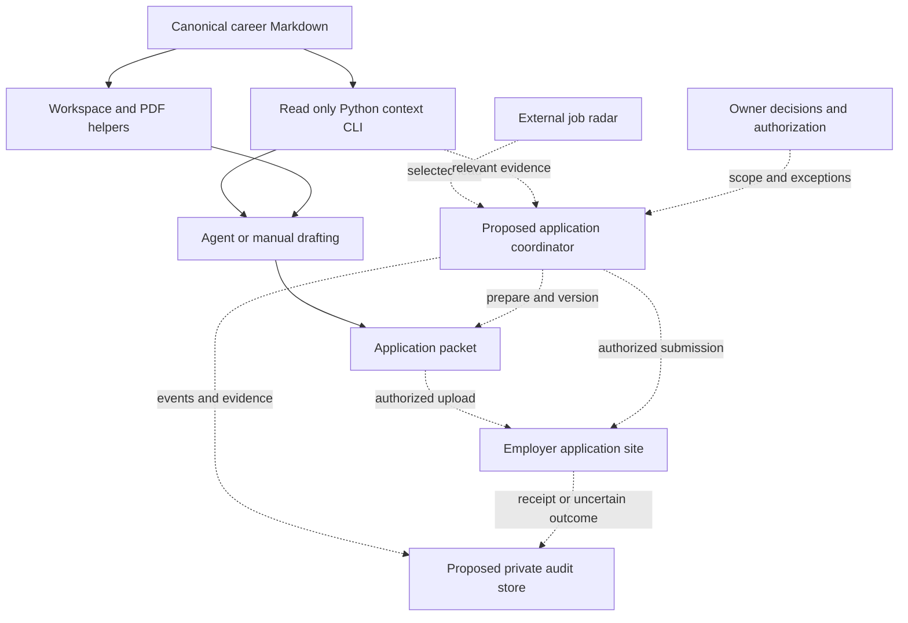

# Technical design

## Components and relationship

Solid arrows below show repository capabilities available today. Dotted arrows
show the proposed integration. The radar already exists externally; the new
coordinator and audit store do not.



The current implementation baseline is commit
[`e36eabb`](https://github.com/matiascshaha/2026/commit/e36eabb980df4e6b4a46e581da822b43820b8fe3).
See the [CLI contract](../agent-workflow.md),
[application workflow](../../README.md), and
[contribution rules](../../CONTRIBUTING.md) for existing behavior.

## Existing repository layer

`context/` contains canonical facts, achievements, wording and quality guidance,
and profile links. `scripts/agent.py` exposes `index`, `search`, `read`, `export`,
and `validate` as JSON using Python 3.10+ and the standard library. It performs no
network calls, writes, drafting, or submission. Search is lexical, and validation
checks structure rather than the truth of claims.

The shell helpers prepare `jobs/<company_slug>/`, create answer templates, and
export completed Markdown to PDFs. They do not write the tailored prose. Snapshots
preserve some prior outputs when a job description changes or a snapshot is
requested; they are not a comprehensive audit, role-level ledger, or proof of
submission. The company-level workspace also needs care when two roles share an
employer. Canonical context links remain live and do not freeze the source version.

## Proposed coordinator

Keep the coordinator outside the read-only CLI. Start with explicit handoffs rather
than a new service: a selected lead and raw job description enter the workflow;
relevant full evidence comes from the CLI; a reviewed packet and outcome record
leave it. A later adapter can automate the same contract.

The lead contract should carry `lead_id`, `source_url`, `employer`, `role_title`,
`provider_job_id` when available, `discovered_at`, `checked_at`, and `availability`.
Generate a separate immutable `application_id`. Prefer employer plus provider job
ID for duplicate matching; otherwise use a normalized canonical URL and role
fingerprint, marking uncertain matches for review. Similar titles alone are not
proof of a duplicate.

For each selected role:

1. Verify the source and availability, then inspect prior application evidence.
2. Save the job-description snapshot and questions. Treat posting text as input,
   not instructions granting new authority.
3. Retrieve relevant evidence and source hashes. Record actual source contents
   used, since working-tree edits may differ from a Git commit.
4. Draft the packet and record supported claims, missing answers, and a short
   explanation of tailoring choices.
5. Freeze a packet revision with file hashes. A review or approval refers to that
   revision and the destination; material later changes require reevaluation.
6. Check the private authorization scope and all outstanding blockers before
   uploading or submitting. Record an attempt before the external action.
7. Record confirmation evidence or an uncertain outcome, then show a concise
   status to the owner. Inspect uncertain outcomes before deciding on any retry.

## Proposed storage

Use a private SQLite ledger for the first single-user implementation, with
versioned artifact files alongside it. This is a proposal, not an installed
component or a final hosting choice. An initial local layout could be:

```text
.private/career-system/
  audit.sqlite
  applications/<application_id>/
    inputs/
    packets/<revision>/
    evidence/
```

Do not change the existing shell helpers' directory contract as part of this
phase. They may prepare a packet in `jobs/<company_slug>/`; the future coordinator
should copy and verify exact inputs and outputs into the application revision
before treating it as frozen. An application ID, rather than a company slug, owns
the audit history.

Suggested logical records:

| Record | Essential fields |
| --- | --- |
| Application | ID, lead/job identity, canonical URL, availability check, current status |
| Packet revision | Application ID, revision, job snapshot, context commit and hashes, artifact paths and hashes, final answers |
| Evidence mapping | Packet claim, source ID/path/hash/lines, brief tailoring explanation |
| Authorization | Application or permitted scope, destination, allowed action/data, packet revision where applicable, source reference, validity/revocation |
| Attempt | Unique ID, application and packet revision, destination, start/end time, confirmed/failed/unknown outcome, receipt reference |
| Event | Event ID, application ID, UTC time, actor, transition, reason, related revision/attempt/evidence |

Append events rather than overwriting past outcomes; corrections get new events.
Use a transaction to reserve a submission attempt and prevent concurrent attempts
for the same confirmed job identity. A local transaction cannot make a website
submission atomic: a crash after clicking submit leaves an unknown outcome that
must be reconciled. Hashes help detect changed files but do not by themselves
make a local store tamper-proof.

Private paths must use appropriate access controls. Before unattended operation,
choose an authorized durable location, encrypted storage/backup, retention rules,
and a tested recovery procedure. Ignored local directories alone are insufficient.
Never store passwords, tokens, or unrelated personal details in the ledger.

## Proposed lifecycle and rollout

Typical application states are `discovered`, `verified`, `drafting`,
`needs_input`, `ready`, `authorized`, `submitting`, and `submitted`. Additional
states include `skipped`, `closed`, `failed`, `submission_unknown`, and
`already_applied`. Store individual attempts separately so retry history remains
visible. Absence of a receipt does not prove that no application was made.

Start with one assisted application and its complete private record. Then add
stable role matching, recoverable storage, and tested exception handling. Only
then consider explicitly scoped unattended submissions. Discovery can continue
independently while submission is paused.

Open decisions: durable storage destination and retention, exact private submission
scope, supported job sites, and which failures require user review. These choices
must be resolved before enabling the corresponding automation, not guessed from
the design document.
